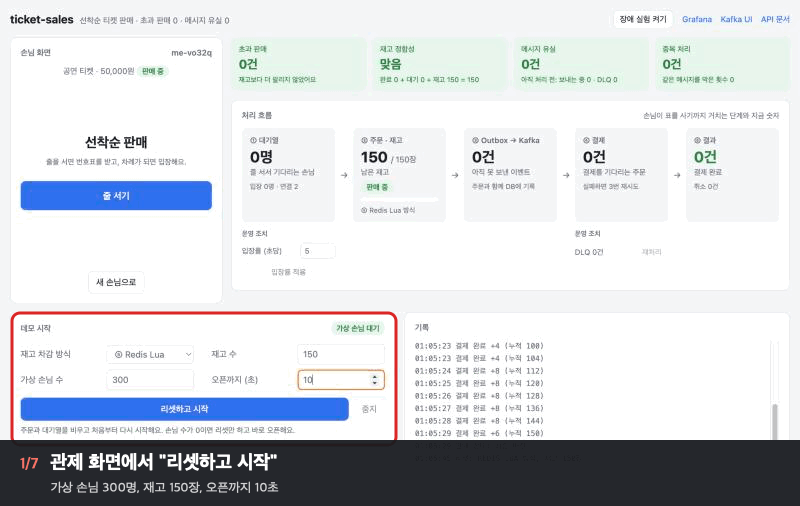

# ticket-sales

공연 티켓 1,000장에 1만 명이 동시에 몰리는 상황을 만들어 두고, 재고보다 더 팔리지 않는지와 장애가 나도 주문이 사라지지 않는지를 숫자로 확인한 백엔드 프로젝트다. 재고 차감 방식 다섯 가지를 같은 조건에서 돌려 비교했고, Kafka를 멈추거나 결제를 일부러 실패시켜 복구되는 과정도 확인했다.

**기술**: Kotlin, Spring Boot, MySQL, Redis, Kafka (측정·화면은 k6, Prometheus, Grafana, React, Docker Compose)

**대표 결과**: 초과 판매 0건 · 메시지 유실 0건 · 정각 1만 명 접속에도 서버 오류 0건 · Redis Lua 차감 처리량이 가장 빠른 DB 방식(비관적 락)의 약 4배



왼쪽은 내가 손님이 되어 쓰는 화면, 오른쪽은 관제 화면이다. 나는 정각에 몰린 가상 손님들과 같은 줄에 서서 표를 산다. 판매 도중 Kafka 발행을 멈추면 이벤트가 Outbox에 쌓이고, 재개하면 모두 발행된다. 그동안 상단의 초과 판매 0과 정합성(완료 주문 + 결제 대기 + 남은 재고 = 150)은 그대로다. GIF는 보기 좋게 가상 손님 300명, 재고 150장으로 줄였다. 직접 해 보는 방법은 [확인하는 순서](#확인하는-순서)에 있다.

---

## 무엇을 확인했나

| 항목 | 목표 | 결과 | 확인 방법 |
|---|---|---|---|
| 초과 판매 | 0건 | 0건 (안전한 방식 4가지) | 동시 주문 테스트, 동시 취소 테스트, 방식 비교 측정 8회(안전한 방식 4가지 × 2회), 오픈 측정 6회 |
| 1만 명 동시 접속 | 서버 오류(5xx)·연결 오류 0건 | 0건 | 오픈 측정: 정각에 1만 명이 2초 안에 몰림, 입장률 3가지 × 2회 |
| 중복 구매 (1인 1장) | 0건 | 0건 | 동시 주문 테스트, 같은 토큰 동시 주문 테스트 |
| 메시지 유실 | 0건 | 0건 | Kafka 브로커 일시정지 테스트, `./demo.sh failure`, [설계](ARCHITECTURE.md#5-메시지-신뢰성) |
| 중복 처리 | 0건 | 0건 | 같은 메시지 2회 발행 테스트, 죽은 프로세스 상태를 재현한 테스트, `./demo.sh failure`, [설계](ARCHITECTURE.md#공통-소비자) |
| 재고 정합성 | 완료 주문 + 결제 대기 주문 + 남은 재고 = 초기 재고 | 맞음 (비교 기준인 락 없음만 깨짐) | 측정 중 실시간, 종료 후 (결제 대기 0) |

여기서 완료 주문은 결제까지 끝난 주문만 센다. 결제 실패나 시간 초과로 취소된 주문은 빠진다. 각 테스트의 조건과 기대 결과는 [ARCHITECTURE.md 9장](ARCHITECTURE.md#9-완료-기준-테스트)에 있다.

## 기능

| 기능 | 설명 |
|---|---|
| 대기열 | 오픈 전에는 카운트다운을 보여 주고, 오픈하면 번호표 순서대로 입장시킨다. 1초에 몇 명을 들여보낼지(입장률)로 뒤쪽 부하를 조절한다. 매진되면 입장을 멈췄다가 취소표가 나오면 다시 연다 |
| 요청 제한 | 대기열에 들어오기 전에 사용자별 초당 허용량(토큰 버킷)으로 거른다 |
| 주문 | 입장 토큰이 있어야 주문할 수 있고, 1인 1장이다 |
| 재고 차감 5가지 | 락 없음, 조건부 UPDATE, 비관적 락, 낙관적 락, Redis Lua. 화면에서 바꿀 수 있다 |
| 결제 | 가짜 PG 1종. 실패율과 지연을 화면에서 넣는다 |
| 보상 | 결제가 실패하거나 결제 대기 시간이 지나면 주문을 취소하고 재고를 돌려놓는다 |
| 장애 실험 | Kafka 발행 중단(화면 버튼), Kafka 브로커 정지(스크립트), 중복 메시지, 결제 실패율 상향, DLQ(실패 메시지를 모아 두는 토픽) 재처리 |
| 화면 | 왼쪽은 내가 손님 1명이 되어 카운트다운부터 구매까지 해 보는 손님 화면, 오른쪽은 결과 지표와 처리 흐름(대기열 → 주문·재고 → Outbox·Kafka → 결제 → 결과)을 보여 주는 관제 화면이다. "장애 실험 켜기"를 누르면 흐름의 각 단계 아래에 장애 버튼이 나타난다. 가상 손님은 k6로 최대 1만 명까지 띄운다 |
| 성능 측정 | k6로 5가지 방식 비교와 오픈 상황(정각에 1만 명)을 측정하고, Grafana로 지표를 본다 |

범위는 공연 티켓 1종의 수량형 판매다. 좌석 지정은 없고, 로그인 대신 `X-User-Id` 헤더로 사용자를 나눈다. 뺀 것과 그 이유는 [ARCHITECTURE.md](ARCHITECTURE.md#10-하지-않은-것)에 적었다.

## 측정 환경

아래 두 결과는 모두 Apple M3 Max(14코어, 36GB)와 OrbStack에서 모든 컨테이너를 한 대에 띄워 쟀다. nginx를 거쳤고 DB 커넥션 풀은 10, k6는 2.0.0이다. 같은 기계에서 잰 값이라 절대 숫자보다 방식끼리의 차이를 보는 게 맞다.

## 결과: 재고 차감 5가지

가상 손님 2,000명이 입장 토큰을 받아 둔 상태에서 동시에 한 번씩 주문하고, 재고는 500장이다. 방식마다 리셋한 뒤 같은 조건으로 두 번 측정해 범위로 적었다(`./demo.sh compare`, 측정 기록: [1회차](k6/results/compare-run1.md) · [2회차](k6/results/compare-run2.md)).

| 방식 | TPS | p95 | 성공 | 품절 | 초과 판매 | 낙관적 락 충돌 | 혼잡(503) | 정합성 |
|---|---|---|---|---|---|---|---|---|
| 락 없음 | 378 ~ 457 | 4.1 ~ 5.0초 | 2,000 | 0 | 1,500장 | — | 0 | 깨짐 |
| 조건부 UPDATE | 1,243 ~ 1,354 | 1.4 ~ 1.5초 | 500 | 1,500 | 0 | — | 0 | 맞음 |
| 비관적 락 | 1,393 ~ 1,485 | 1.3 ~ 1.4초 | 500 | 1,500 | 0 | — | 0 | 맞음 |
| 낙관적 락 | 904 ~ 914 | 2.1초 | 500 | 1,234 ~ 1,242 | 0 | 4,499 ~ 4,500회 | 258 ~ 266건 (13%) | 맞음 |
| Redis Lua | 5,946 ~ 6,044 | 0.23 ~ 0.26초 | 500 | 1,500 | 0 | — | 0 | 맞음 |

TPS는 초당 처리한 요청 수다. 품절(409)로 끝난 요청도 세므로, 재고가 500장인 이 측정에서는 성공 500건과 품절 1,500건을 합친 2,000건을 얼마나 빨리 처리했는지를 뜻한다. p95는 요청 100건 중 95건이 이 시간 안에 끝났다는 뜻이다. 혼잡(503)은 낙관적 락이 재시도 한도를 넘겨 거절한 주문이다.

Redis Lua는 DB 방식 중 가장 빠른 비관적 락보다 4배쯤 빠르다. 재고 경쟁을 Redis 안에서 원자적으로 끝내고, DB에는 주문 저장만 남기 때문이다.

조건부 UPDATE와 비관적 락은 거의 차이가 없다. 조건부 UPDATE도 주문 저장과 같은 트랜잭션 안에서 돌아서 행 잠금이 커밋할 때까지 풀리지 않는다. 결국 비관적 락처럼 한 줄로 서서 처리된다.

낙관적 락은 경쟁이 심하면 가장 느린 안전한 방식이 된다. 충돌할 때마다 새 트랜잭션으로 다시 시도하다 보니 충돌이 4,500번쯤 쌓였고, 10번 시도해도 성공하지 못한 13%는 503을 받았다.

락이 없으면 재고 500장에 2,000장이 팔린다. 여러 요청이 같은 재고 값을 읽고 각자 덮어쓰면서 갱신이 사라진다. 락 없음이 가장 느린 것도 같은 이유다. 재고가 제대로 줄지 않아 2,000건이 모두 주문 저장과 커밋까지 가므로, 1,500건이 품절로 바로 끝나는 다른 방식보다 할 일이 4배 많다.

## 결과: 오픈 상황 (1만 명)

정각에 가상 손님 1만 명이 2초 안에 대기열로 들어오고, SSE로 순번을 받다가 입장하면 주문한다. 재고는 1,000장, 방식은 Redis Lua다. 입장률마다 두 번씩 측정했다(`./demo.sh open`, 측정 기록: [1회차](k6/results/open-run1.md) · [2회차](k6/results/open-run2.md)).

| 입장률(초당) | 최대 SSE 연결(서버 집계) | 줄 서기 API p95 | 주문 p95 | 입장 후 품절 | 서버 오류·연결 오류 | 초과 판매 | 정합성 |
|---|---|---|---|---|---|---|---|
| 100 | 9,802 | 202 ~ 308ms | 178 ~ 239ms | 0명 | 0 | 0 | 맞음 |
| 500 | 9,271 ~ 9,502 | 436 ~ 563ms | 271 ~ 399ms | 500명 | 0 | 0 | 맞음 |
| 2,000 | 8,502 ~ 9,266 | 516 ~ 607ms | 342 ~ 516ms | 3,000 ~ 5,553명 | 0 | 0 | 맞음 |

세 경우 모두 서버 오류와 연결 오류는 한 건도 없었다.

차이는 입장률에서 났다. 초당 100명이면 주문 p95가 가장 낮고 입장한 사람은 모두 표를 산다. 초당 2,000명으로 올리면 재고보다 훨씬 많은 사람이 한꺼번에 들어와서, 수천 명이 입장하고 나서야 매진을 확인하고 주문 지연도 길어진다. 입장률을 낮게 잡을수록 서버는 편하지만 줄은 길어지니, 실제 서비스라면 둘 사이에서 값을 고르게 된다.

**표 읽는 법.** 입장률은 대기열이 1초에 들여보내는 인원이다. 줄 서기 API p95는 줄에 서는 요청의 응답 시간이고, 실제로 기다린 시간이 아니다. 입장 후 품절은 입장은 했지만 그사이 재고가 떨어져 사지 못한 사람 수다.

**측정상 주의.** 최대 SSE 연결은 서버 목록에 남은 연결 수다. 서버는 닫힌 연결을 다음 전송이나 15초 heartbeat 때 빼므로, 입장률 500·2,000에서는 먼저 입장해 닫은 연결까지 섞여 실제보다 많다. 입장률 100에서는 최대 약 9,800개로, 입장하지 않고 기다리던 인원(최대 약 9,700명, 측정 기록의 "최대 동시 대기")과 거의 같았다. 입장률 2,000의 입장 후 품절은 두 회차 편차가 커서 "입장률이 높을수록 급격히 늘어난다"는 경향으로만 본다.

**표에 없는 값.** 입장까지 기다린 시간(p95)은 입장률 100에서 약 9초, 500과 2,000에서는 약 3초였다. 500부터는 재고가 먼저 떨어져 입장이 멈추므로 둘 사이 차이가 거의 없다.

## 구조

```
손님 화면·관제 화면 (React) ─┐
가상 손님 1만 명 (k6) ───────┴─▶ nginx ─▶ 앱 (Spring Boot 1개)
                                          │
              ┌───────────────────────────┼───────────────────────────┐
              ▼                           ▼                           ▼
            Redis                       MySQL                       Kafka
     대기열·입장 토큰·요청 제한      주문·Outbox·재고(DB 방식)     주문 → 결제 → 완료/취소 → 재고 복구
     재고(Redis 방식)·멱등 키                                       재시도 3번 → DLQ
```

줄 서기와 순번은 Redis 대기열이 맡는다. 덕분에 재고 차감과 주문 트랜잭션 같은 무거운 일은 입장률만큼만 DB에 들어간다. 주문은 DB 트랜잭션 안에서 Outbox 테이블에 이벤트를 같이 적고, 발행기가 그걸 Kafka로 보낸다. 그래서 Kafka가 잠깐 멈춰도 이벤트는 DB에 남아 있다. 결제, 취소, 재고 복구는 모두 Kafka 이벤트로 이어지고, 세 번 재시도해도 실패한 메시지는 DLQ로 빠진다. 재고 차감은 같은 인터페이스 뒤에 다섯 가지 구현을 두고 하나를 골라 쓴다. 왜 이렇게 나눴는지는 [ARCHITECTURE.md의 주요 판단](ARCHITECTURE.md#주요-판단)에 표로 정리했고, 용어는 [먼저 알아둘 용어](ARCHITECTURE.md#먼저-알아둘-용어)에 있다.

## 실행

Docker만 있으면 된다. JDK와 Node는 이미지 안에서 빌드한다.

```bash
./demo.sh up                 # 전체 기동 (빌드 포함, 준비될 때까지 기다림)
./demo.sh                    # up + compare: 기동한 뒤 5가지 방식 비교 측정
./demo.sh failure            # 장애 데모: Kafka 브로커 정지·재시작, 중복 메시지, 결제 실패 보상, DLQ 재처리
./demo.sh compare            # 재고 차감 5가지 방식 연속 측정 → 결과표
./demo.sh open               # 오픈 상황 측정: 정각에 1만 명, 입장률별 결과표
./demo.sh crowd              # 가상 손님 투입 (관제 화면의 데모 시작 카드와 같다)
docker compose down          # 전체 종료
```

테스트는 `backend`에서 `./gradlew test`로 돌린다. 구조 규칙 검사, 실제 MySQL·Redis·Kafka를 띄우는 통합 테스트, 동시성, 장애 복구 테스트가 들어 있다. JDK 21이 필요하고, MySQL·Redis·Kafka는 Testcontainers가 Docker로 띄운다. 락 없음 방식의 초과 판매 재현은 결과가 실행마다 달라 따로 뺐고, `./gradlew demoTest`로 돌린다. 어떤 테스트가 무엇을 확인하는지는 [ARCHITECTURE.md 9장](ARCHITECTURE.md#9-완료-기준-테스트)에 표로 정리했다.

기동 후 주소

| 무엇 | 주소 |
|---|---|
| 손님·관제 화면 | `http://localhost` |
| API (nginx) | `http://localhost/api` |
| API 문서 | `http://localhost/swagger-ui` |
| Grafana (로그인 없음) | `http://localhost:3000` |
| Prometheus | `http://localhost:9090` |
| Kafka UI | `http://localhost:8081` |

## 확인하는 순서

| 단계 | 시간 | 방법 |
|---|---|---|
| ① 보기만 | 30초 | 이 README의 GIF와 결과표 |
| ② 자동 데모 | 5분 | `./demo.sh` |
| ③ 장애 데모 | 2분 | `./demo.sh failure` |
| ④ 직접 해 보기 | 1분 | `./demo.sh up`으로 띄운 뒤 `http://localhost` 관제 화면에서 "리셋하고 시작" → 30초 카운트다운 → 정각에 손님 화면에서 줄 서기 |
| ⑤ 테스트 | 자동 | GitHub Actions (`.github/workflows/ci.yml`)에 백엔드 테스트, 화면 빌드, Compose 설정 검사를 구성해 두었다 |

## AI 활용

구현은 AI 코딩 도구(Claude Code)와 함께 했다. 설계와 완료 기준은 직접 정하고, AI는 그 안에서 구현하게 했다.

- 설계 원본은 [ARCHITECTURE.md](ARCHITECTURE.md)다. AI가 구현하다 설계와 부딪히면 코드를 우회하지 않고 멈추고, 문서부터 고친다. AI용 작업 지시는 [CLAUDE.md](CLAUDE.md)에 있다.
- 의존 방향 같은 구조 규칙은 ArchUnit으로 빌드에서 막고, 규칙마다 위반 예제를 둬서 규칙이 실제로 잡는지도 확인한다.
- 완료는 미리 적어 둔 완료 기준 테스트의 통과로만 인정한다. 기대 결과를 사람이 정하므로 AI가 테스트를 구현에 맞춰 느슨하게 바꿀 수 없다.
- 예: AI에게 코드 리뷰를 맡겼다가 "동시에 온 두 취소가 재고를 두 번 복구할 수 있다"는 지적을 받았다. 바로 고치지 않고 테스트로 먼저 재현했고(주문 100건 모두 취소 이벤트가 2건씩), 주문 행 잠금으로 고친 뒤 그 테스트를 완료 기준에 추가했다. 원인은 기존 테스트가 순서대로 오는 경우만 다룬 것이었다. 그래서 이후 동시성이 걸린 완료 기준에는 "동시에"를 명시한다.

## 문서

| 문서 | 내용 |
|---|---|
| [ARCHITECTURE.md](ARCHITECTURE.md) | 인프라 구조, 요청 흐름, 재고 차감 5가지, 메시지 신뢰성, 데모·측정, 규칙, 완료 기준 테스트, 하지 않은 것 |
| [CLAUDE.md](CLAUDE.md) | AI가 이 저장소에서 작업할 때 읽는 지시서 |
